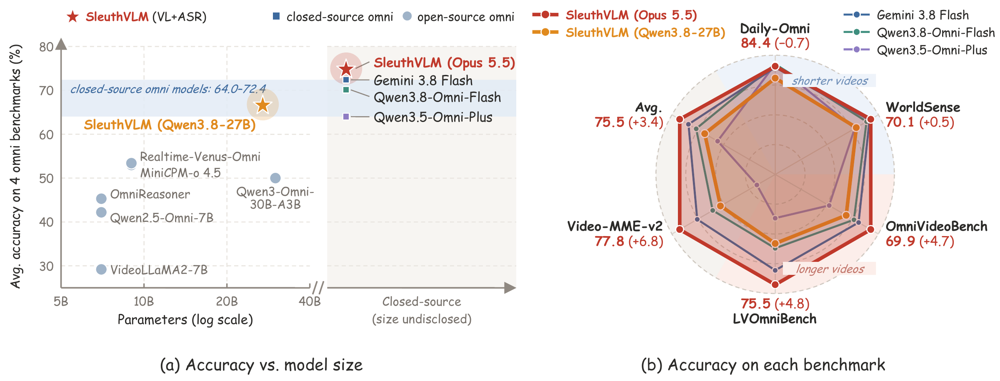
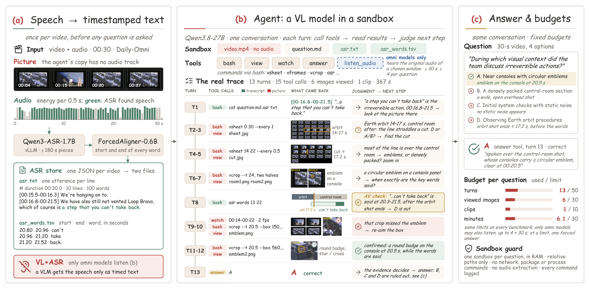
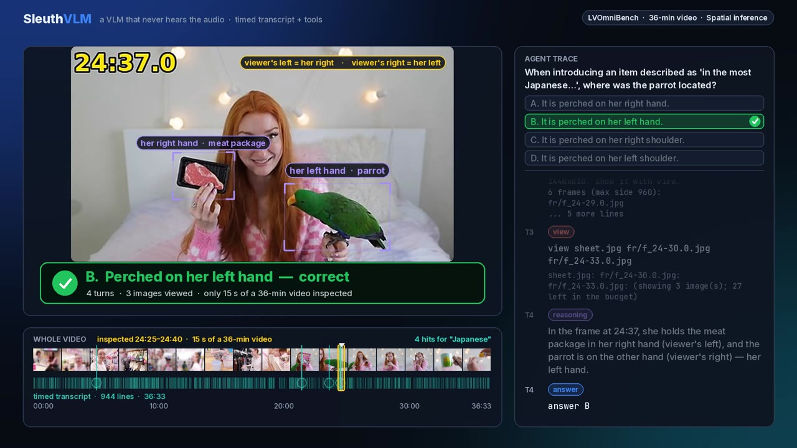
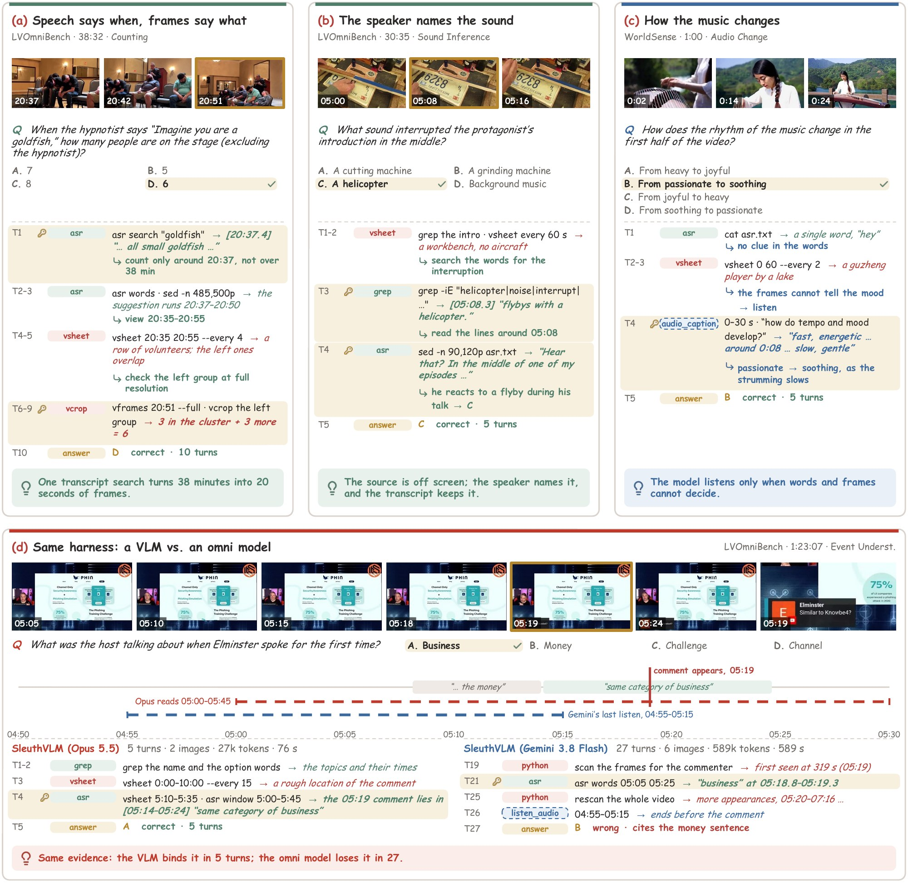

<h1 align="center">OpenOmniHarness</h1>

<h3 align="center">An Open Agentic Harness for Omni Video Understanding</h3>

<p align="center">
  <a href="https://wpr001.github.io/sleuthVLM/"></a>
  <a href="https://arxiv.org/abs/2611.06083"></a>
  <a href="https://wpr001.github.io/sleuthVLM/Do_We_Really_Need_Audio_in_Video_for_Omni_Video_Understanding.pdf"></a>
  <a href="https://wpr001.github.io/sleuthVLM/#demo"></a>
  <a href="LICENSE"></a>
</p>

<p align="center">
  <a href="https://wpr001.github.io/sleuthVLM/">
    
  </a>
</p>

<p align="center"><em>
Hand a model a video, a transcript and a shell, and let it sleuth: search what was said, look where it matters,<br>
zoom in, replay a moment, and answer once the evidence decides.
</em></p>

<a id="highlights"></a>
## ✨ Highlights

- **Training-free.** Bring a VLM that can call tools, and it is ready to go. Nothing is fine-tuned.
- **Free-form.** The model gets a sandbox, a short guide and a budget, then makes its own calls: where to look, how
  closely, and when it has seen enough.
- **Audio as text, with optional direct listening.** The default visual mode uses word-timed transcripts.
  `--agent-mode omni` also lets an audio-capable model request short raw-audio segments with `listen_audio`.
- **Official Gemini backend.** Omni mode uses Google's `google-genai` SDK and the official Gemini API.
  Credentials come from the `GEMINI_API_KEY` environment variable.
- **Plug and play.** Tools, sandbox commands and rules are switched on by name, so a new idea is one flag away.
- **A strong baseline to beat.** [SleuthVLM](https://wpr001.github.io/sleuthVLM/) runs Qwen3.8-27B on a single GPU
  and is comparable to open-source omni models on short videos and better on long ones. With Claude Opus 5.5, the
  same harness leads every closed-source omni model on average.

<a id="supported-models"></a>
## Supported Models

| Model | Deployment | Agent modes |
|---|---|---|
| Qwen3.8-27B | Local, via vLLM or Hugging Face Transformers | `visual` — video frames + ASR |
| Gemini | Official Gemini API | `visual` — video frames + ASR; `omni` — adds on-demand audio listening |

<a id="roadmap"></a>
## 🗺️ Roadmap

- [x] **Offline Omni Harness:** recorded videos with transcripts prepared ahead of time, and the SleuthVLM baseline
  on Daily-Omni, WorldSense, OmniVideoBench, LVOmniBench and your own videos
- [ ] **[Online Omni Harness](#online-omni-harness):** coming soon

<a id="contents"></a>
## 🗂️ Contents

- [Supported Models](#supported-models)
- [How It Works](#how-it-works)
- [SleuthVLM: The Offline Baseline](#sleuthvlm)
  - [Results](#results) · [See It at Work](#see-it-at-work)
- [Installation](#installation)
- [Quick Start](#quick-start) · [Omni Agentic Mode](#omni-agentic-mode)
- [Evaluation](#evaluation)
  - [Prepare the Data](#prepare-the-data) · [Run](#run) · [Options](#options) · [Outputs](#outputs)
- [Extend the Harness](#extend-the-harness)
  - [Add a Tool](#add-a-tool) · [Add a Sandbox Command](#add-a-sandbox-command) · [Add a Rule](#add-a-rule)
- [Contributing](#contributing)
- [Repository Layout](#repository-layout) · [Online Omni Harness](#online-omni-harness) · [Citation](#citation)

<a id="how-it-works"></a>
## 🔍 How It Works

The Offline Omni Harness works on recorded videos. In the default visual mode, it transcribes speech once, then
lets the model search the transcript and inspect relevant video moments. Omni mode adds a `listen_audio` tool:
the model selects a time interval, receives the actual audio from that interval, and continues the same conversation.

<p align="center">
  
</p>

### Step 1 · Speech becomes a timed transcript

Qwen3-ASR-1.7B transcribes the speech, and Qwen3-ForcedAligner-0.6B stamps every word with its start and end time.
Stretches without recognized words stay in the transcript as gaps. They may contain non-speech sounds or missed
speech; an ASR gap does not establish silence or the presence of music.

### Step 2 · The model sleuths the video

Each question gets its own sandbox with the muted video, the question and the transcript. The model works through
the four default tools:

| tool | what it does |
|---|---|
| `bash` | runs a command in the sandbox: the commands below, `python3`, `ffmpeg`, `grep`, ... |
| `view` | shows up to 4 image files (contact sheets, frames, crops) |
| `watch` | shows a segment of up to 30 s as video |
| `answer` | gives the option letter and ends the question |
| `listen_audio` (omni mode) | returns original audio from an absolute time interval; default budget: 4 calls, 30 s each |

Inside `bash`, a handful of commands cover the video and the transcript:

| command | what it does |
|---|---|
| `vprobe` | duration, size and frame rate |
| `vsheet T0 T1 --every S` | contact sheet of time-stamped frames |
| `vframes T0 T1 --fps F [--full]` | single frames |
| `vcrop --t T --box x0,y0,x1,y1` | crop of a native-resolution frame |
| `asr window / search / words / gaps` | transcript lines, search, word times, stretches without speech |

The model can also write code within the sandbox, for example to crop and enlarge a region or to tile frames into
its own sheet. Original audio stays outside the sandbox; `listen_audio` extracts only the requested interval under
the configured listening budget.

### Step 3 · It answers when the evidence decides

The model answers as soon as the evidence settles the question. Every question gets the same budget: 50 turns,
30 viewed images, 10 watch clips and 30 minutes.

<a id="sleuthvlm"></a>
## 🏆 SleuthVLM: The Offline Baseline

SleuthVLM is the first baseline built on this harness and the method of our paper
*SleuthVLM: Do We Really Need Audio-in-Video for Omni Video Understanding?*
([arXiv](https://arxiv.org/abs/2611.06083) · [PDF](https://wpr001.github.io/sleuthVLM/Do_We_Really_Need_Audio_in_Video_for_Omni_Video_Understanding.pdf) · [project page](https://wpr001.github.io/sleuthVLM/)).
Its reasoning model never hears the audio directly. It reads the speech as a timed transcript and searches the video
on its own, without a predefined workflow.

<a id="results"></a>
### Results

Accuracy (%) on four omni benchmarks. A+V: audio as input; V+ASR: speech as a timed transcript; medium: medium
reasoning effort, the default of this release.

| Model | Input | Daily-Omni | WorldSense | OmniVideoBench | LVOmniBench | Avg. |
|---|---|:---:|:---:|:---:|:---:|:---:|
| Gemini 3.8 Flash | A+V | 84.0 | 69.6 | 65.2 | 70.7 | 72.4 |
| Qwen3.8-Omni-Flash | A+V | **85.1** | 68.5 | 63.4 | 63.3 | 70.1 |
| OmniVideo-R1 | A+V | 82.8 | 65.8 | 44.8 | – | – |
| Qwen3-Omni-30B-A3B | A+V | 71.9 | 54.0 | 38.4 | 35.8 | 50.0 |
| **SleuthVLM** (Qwen3.8-27B, medium) · this release | V+ASR | 80.3 | 62.8 | 58.3 | 60.2 | 65.4 |
| **SleuthVLM** (Claude Opus 5.5) | V+ASR | 84.4 | **70.1** | **69.9** | **75.5** | **75.0** |

The Qwen3.8-27B setting runs out of the box with this release on a single GPU. With Claude Opus 5.5, SleuthVLM also
tops the Video-MME-v2 leaderboard with 77.8%. Full leaderboards, ablations and more trajectories are in the paper
and on the [project page](https://wpr001.github.io/sleuthVLM/#results).

<a id="see-it-at-work"></a>
### See It at Work

<p align="center">
  <a href="https://wpr001.github.io/sleuthVLM/#demo">
    
  </a>
  <br>
  <em>SleuthVLM answers two questions on 36- and 59-minute videos, replayed from its logged trajectories. Click to watch.</em>
</p>

<details>
<summary><b>Four example trajectories</b></summary>
<p align="center">
  
</p>

(a, b) Answered from the transcript and the picture; (c) with an audio caption tool; (d) one question answered in
the same harness by a VLM and by an omni model. Highlighted rows hold the decisive evidence; green: transcript,
red: picture, blue: audio.
</details>

<a id="installation"></a>
## 🛠️ Installation

### 1. Create the environments

For local visual inference, two conda environments keep the agent and the transcription apart:

```bash
git clone https://github.com/WPR001/OpenOmniHarness.git
cd OpenOmniHarness
conda create -n omniharness python=3.12 -y
conda run -n omniharness pip install -r requirements.txt            # agent
conda create -n omniharness-asr python=3.12 -y
conda run -n omniharness-asr pip install -r requirements-asr.txt    # transcripts
```

You'll also need `ffmpeg` and `ffprobe` on `PATH` for video decoding and audio extraction.

For API-only Gemini inference, install this CPU environment:

```bash
python3.12 -m venv .venv-omni
. .venv-omni/bin/activate
python -m pip install -r requirements-omni.txt
```

Reuse existing ASR files, or prepare them separately with the ASR environment. The API environment does not run ASR.
Local reasoning-model downloads in step 2 are needed only for the local backends.

### 2. Download the models

```bash
OH_MODEL_DIR=models bash scripts/download_models.sh   # Qwen3.8-27B, Qwen3-ASR-1.7B, Qwen3-ForcedAligner-0.6B
```

### 3. Set the paths

Everything else is configured with environment variables:

| variable | default | |
|---|---|---|
| `OH_MODEL_DIR` | `./models` | model folder (models not found there load from Hugging Face) |
| `QWEN38_PATH`, `QWEN3_ASR_PATH`, `QWEN3_ALIGNER_PATH` | | one model each |
| `OMNI_BENCH_ROOT` | `./data` | benchmark data |
| `OH_ASR_CACHE` | `./cache/asr` | transcripts |
| `OH_MUTED_CACHE` | `./cache/muted` | videos without audio, made on first use |
| `OH_SCRATCH` | `/tmp/omniharness_sandbox` | per-question sandboxes |
| `GEMINI_API_KEY` | unset | official Gemini Developer API credential, provided by your environment |

<a id="quick-start"></a>
## 🚀 Quick Start

Got a video and a question? Two commands, run from the repository root:

```bash
# 1. transcript (omniharness-asr env)
python asr/build.py --videos <(echo /path/clip.mp4)
# 2. answer (omniharness env)
python infer/run_single.py --video /path/clip.mp4 \
    --question "What does the host say right after the applause?" \
    --options "A. Thank you" "B. Wow, what a crowd" "C. Let's begin" "D. Nothing" \
    --out outputs/single/clip.json
```

You'll get the answer along with the full record of every tool call the model made.

<a id="omni-agentic-mode"></a>
### Omni Agentic Mode

Set `GEMINI_API_KEY` securely in your shell or secret manager, then use the official Gemini backend:

```bash
python infer/run_single.py --agent-mode omni --model gemini-3.8-flash \
    --video /path/clip.mp4 \
    --question "What sound follows the door closing?" \
    --options "A. A dog barking" "B. Applause" "C. A phone ringing" "D. Running water" \
    --max-listen 4 --listen-seconds 30 \
    --out outputs/single/clip_omni.json
```

Omni mode selects `--backend gemini` and adds `listen_audio` to the default tools. The model can read ASR, inspect
frames, request an audio interval, and continue reasoning; no audio is sent until it requests a listen. Explicit
`--tools` replaces the tool list, so include `listen_audio` when selecting tools manually. `--max-listen 0` disables it.

```bash
# Official Gemini with raw audio available on demand
python infer/run_bench.py --bench lvomnibench --agent-mode omni \
    --model gemini-3.8-flash --api-workers 4 --batch-size 4 \
    --out outputs/lvomnibench/gemini_omni

# Same official model with V + ASR only
python infer/run_bench.py --bench lvomnibench --agent-mode visual --backend gemini \
    --model gemini-3.8-flash --api-workers 4 --batch-size 4 \
    --out outputs/lvomnibench/gemini_visual
```

The API adapter connects directly to Google's Gemini Developer API. The local `hf` and `vllm` backends support
visual inference; Omni mode currently uses the official Gemini adapter. Add `--gemini-thinking-level high` to
set Gemini's thinking level, or omit it to use the model default.

`listen_audio(t0, t1)` uses absolute media timestamps in seconds, `mm:ss`, or `hh:mm:ss`. Each extracted segment
is returned as mono 16 kHz PCM WAV with its original time offset. `--max-listen` controls the per-question call
budget; `--listen-seconds` controls each segment's maximum duration. Audio decoding consumes one call, including
failed decoding attempts; invalid timestamps and missing audio tracks return an error without consuming a call.

<a id="evaluation"></a>
## 📊 Evaluation

<a id="prepare-the-data"></a>
### Prepare the Data

Place the four benchmarks under `OMNI_BENCH_ROOT` like this:

```text
Daily-Omni/qa.json             Daily-Omni/Videos/<vid>/<vid>_video.mp4
WorldSense/worldsense_qa.json  WorldSense/videos/<id>.mp4
OmniVideoBench/data.parquet    OmniVideoBench/videos/<name>.mp4
LVOmniBench/data.json          LVOmniBench/videos/<video_id>.mp4
```

<a id="run"></a>
### Run

Run everything from the repository root. The Slurm scripts take one GPU per array task; `PYTHON` points to the
environment's python, and `EXTRA` passes extra flags.

```bash
# 1. transcripts for the four benchmarks (4 GPUs)
PYTHON=$(conda run -n omniharness-asr which python) \
BENCH="daily_omni worldsense omnivideobench lvomnibench" sbatch --array=0-3 asr/slurm/build_asr.sbatch

# 2. the agent (4 GPUs, one shard each)
PYTHON=$(conda run -n omniharness which python) BENCH=lvomnibench sbatch --array=0-3 infer/slurm/run_bench.sbatch
PYTHON=... BENCH="daily_omni worldsense" sbatch --array=0-3 infer/slurm/run_bench.sbatch
PYTHON=... BENCH=omnivideobench EXTRA="--limit 8 --tag _smoke" sbatch infer/slurm/run_bench.sbatch

# or directly on a GPU
python infer/run_bench.py --bench lvomnibench --num-shards 4 --shard-id 0

# 3. scores
python infer/score.py --bench lvomnibench --run-dir outputs/lvomnibench/agent_vllm
```

Results are saved question by question, so if a run stops, launch the same command again and it picks up where it
left off. The first log line for each benchmark tells you how many questions have transcripts ready.

<a id="options"></a>
### Options

| flag | default | |
|---|---|---|
| `--tools` | `bash view watch answer` | omni mode additionally offers `listen_audio`; explicit lists replace defaults |
| `--rules` | none | optional rules |
| `--agent-mode` | `visual` | `omni` enables the direct-audio agent mode |
| `--backend` | mode dependent | visual: `vllm`; omni: `gemini`; explicit choices: `vllm`, `hf`, `gemini` |
| `--model` | backend dependent | local Qwen3.8-27B path/ID, or `gemini-3.8-flash` for Gemini |
| `--max-listen`, `--listen-seconds` | `4`, `30` | per-question audio calls and maximum duration per call |
| `--api-workers`, `--api-timeout`, `--api-retries` | `4`, `180`, `2` | simultaneous Gemini requests, timeout seconds, retries after the initial request |
| `--gemini-thinking-level` | model default | optional `low`, `medium`, `high`; separate from local Qwen reasoning effort |
| `--tp` | 1 | tensor parallel GPUs |
| `--limit`, `--uids`, `--uids-file` | | a subset of questions |
| `--tag`, `--out` | | run directory name |
| `--keep-sandbox` | off | keep the per-question directories |

<a id="outputs"></a>
### Outputs

Default run directories are `outputs/<bench>/agent_<backend><tag>/` in visual mode and
`outputs/<bench>/agent_gemini_omni<tag>/` in omni mode; `--out` selects an explicit directory:

- `results_shard<i>of<n>.jsonl`: one record per question, with the prediction, the stop reason, every turn with its
  tool calls and outputs, the images viewed and the time spent;
- `config_shard<i>of<n>.json`: the run settings;
- `scores.json`: accuracy overall and per benchmark dimension, with tool and stop statistics.

Omni records also include listening intervals and audio-extraction metadata; Gemini records include per-request and
aggregate token usage. Audio bytes, credentials and provider signature payloads are not written into result JSON.
Use separate output directories for visual and omni comparisons. Gemini resumes check the model, mode, tools,
budgets and thinking configuration before skipping existing question IDs.

<a id="extend-the-harness"></a>
## 🧩 Extend the Harness

Tools and rules are switched on by name, so you can try a new idea with one flag while the default setting stays
exactly as it is.

<a id="add-a-tool"></a>
### Add a Tool

Add a module to `omniharness/tools/`, import it in `omniharness/tools/__init__.py`, and offer it with `--tools`:

```python
# omniharness/tools/ocr.py
from .base import ToolInputError, register


@register('ocr', 'Read the text in an image file from the sandbox.',
          {'type': 'object', 'properties': {'path': {'type': 'string', 'description': 'image file name'}},
           'required': ['path']},
          prompt='\n\nAlso available: the ocr tool reads the text in an image file.')
def ocr(box, args):
    path = box.sb.path(args.get('path', ''))      # a file inside the sandbox
    ...                                           # box.cfg, box.images, box.watches, box.state
    return [{'type': 'text', 'text': text}]       # or {'type': 'image', 'image': PIL.Image}
```

```bash
python infer/run_bench.py --bench daily_omni --tools bash view watch answer ocr
```

`prompt` joins the system prompt whenever the tool is offered, and `ToolInputError` passes an error message back to
the model.

<a id="add-a-sandbox-command"></a>
### Add a Sandbox Command

Register an argparse function in `omniharness/commands/`, add its wrapper, and list it in the system prompt
(`omniharness/agent/prompts.py`):

```python
@command('vdiff', positional=('t0', 't1'))
def vdiff(argv=None):
    p = argparse.ArgumentParser(prog='vdiff', description='...')
    ...
```

```bash
cp omniharness/commands/bin/vsheet omniharness/commands/bin/vdiff
```

<a id="add-a-rule"></a>
### Add a Rule

A rule can add a line to the prompt's Rules section, refuse bash commands by pattern, and refuse tool calls,
including `answer`. Register it in `omniharness/rules/extra.py` and switch it on with `--rules`:

```python
register(Rule(
    name='look_before_answer',
    prompt='Look at the video (view or watch) at least once before you answer.',
    check=lambda name, args, box: ('look at the video first (view or watch)'
                                   if name == 'answer' and not (box.images or box.watches) else None)))

register(Rule(
    name='no_python',
    prompt='Use the commands for the video; python3 is not available.',
    command=re.compile(r'\bpython3?\b'),
    reason='python3 is not available in this setting'))
```

```bash
python infer/run_bench.py --bench daily_omni --rules look_before_answer no_python
```

Refused commands are listed in each record's `denied`, and refused tool calls in `refused`.

### More Entry Points

- Prompts: `omniharness/agent/prompts.py`.
- Sampling and generation settings: `AgentConfig` in `omniharness/config.py`, flags in `infer/common.py`.
- A new benchmark: a `Benchmark` subclass in `omniharness/benchmarks/` whose `load()` returns `Sample`s, added to
  `BENCHMARKS`.

<a id="contributing"></a>
## 🤝 Contributing

OpenOmniHarness is built to grow with the community, and SleuthVLM is just its first offline baseline. If you have a
tool or a rule that helps a model understand videos, we'd love to see it!

### What We'd Love to See

- **Tools:** audio captioning, sound event detection, speaker diarization, music analysis, OCR, object tracking,
  shot detection, or retrieval over long videos.
- **Rules:** checks that make the agent look before it answers, verify a candidate answer, or balance search and
  inspection within the budget.
- **Benchmarks and backends:** new omni video benchmarks, with full results of the default setting on them, and
  other reasoning models, with full results on the four benchmarks.

### What Every Pull Request Includes

Every pull request comes with **a full benchmark comparison**, so everyone can see what the new piece brings:

1. **A name to switch it on.** Register the tool or rule so that `--tools` or `--rules` turns it on (see
   [Extend the Harness](#extend-the-harness)).
2. **All four benchmarks.** Run the complete Daily-Omni, WorldSense, OmniVideoBench and LVOmniBench with the same
   reasoning model and budget as the default setting.
3. **A side-by-side comparison.** Report the default setting and yours together: accuracy on each benchmark and the
   average, plus the `scores.json` of every run.
4. **A moment where it shines.** Add one trajectory where your tool or rule decides the answer, and a line for it in
   the tables above.

Have an idea or a question first? Open an [issue](https://github.com/WPR001/OpenOmniHarness/issues) and let's talk.

<a id="repository-layout"></a>
## 📁 Repository Layout

```text
omniharness/
  config.py        paths; AgentConfig (budgets, sampling, tools, rules)
  agent/           loop.py (the agent loop), prompts.py (system prompt and fixed messages)
  tools/           bash.py, view.py, watch.py, answer.py, listen_audio.py; registry and ToolBox
  sandbox/         sandbox.py: per-question work dir and bash runner
  commands/        video.py (vprobe, vsheet, vframes, vcrop), asr.py; bin/ wrappers
  rules/           guard.py (built-in command guard), extra.py (optional rules)
  media/           video.py, transcript.py, audio.py (bounded raw-audio extraction)
  backends/        vllm_backend.py, hf.py, render.py; gemini.py (official API and native tools)
  benchmarks/      daily_omni.py, worldsense.py, omnivideobench.py, lvomnibench.py
asr/               build.py (transcripts), slurm/build_asr.sbatch
infer/             run_single.py, run_bench.py, score.py, slurm/run_bench.sbatch
scripts/           setup_envs.sh, download_models.sh
requirements-omni.txt  API inference dependencies, without CUDA/PyTorch/vLLM
assets/            figures for this README
```

<a id="online-omni-harness"></a>
## 📡 Online Omni Harness

The Online Omni Harness is on its way. Stay tuned!

<a id="citation"></a>
## 📝 Citation

If OpenOmniHarness or SleuthVLM helps your research, please cite:

```bibtex
@article{wu2026sleuthvlm,
  title={SleuthVLM: Do We Really Need Audio-in-Video for Omni Video Understanding?},
  author={Wu, Peiran and Gou, Fangfei and Mu, Zhaoxi and Zhang, Changhao and Liu, Jian and Wang, Weiqiang and Wang, Yuntao and Shi, Yuanchun and Shen, Junxiao},
  journal={arXiv preprint arXiv:2611.06083},
  year={2026}
}
```

<a id="misc"></a>
## 📌 Misc

### Star History

<p>
  <a href="https://www.star-history.com/#WPR001/OpenOmniHarness&Date">
    
  </a>
</p>

### Acknowledgements

Transcripts are built with Qwen3-ASR and Qwen3-ForcedAligner, and the reasoning model is served with
[vLLM](https://github.com/vllm-project/vllm). We evaluate on Daily-Omni, WorldSense, OmniVideoBench and
LVOmniBench. Many thanks to their authors for sharing them!

### License

OpenOmniHarness is released under the [MIT License](LICENSE).
